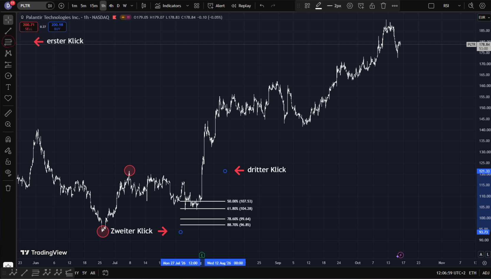
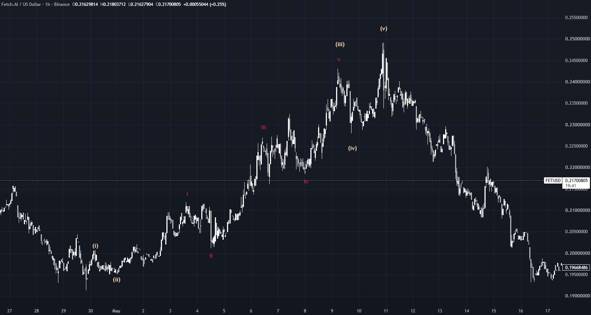
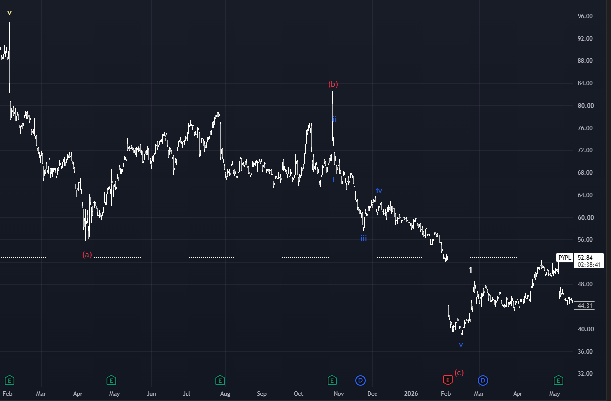
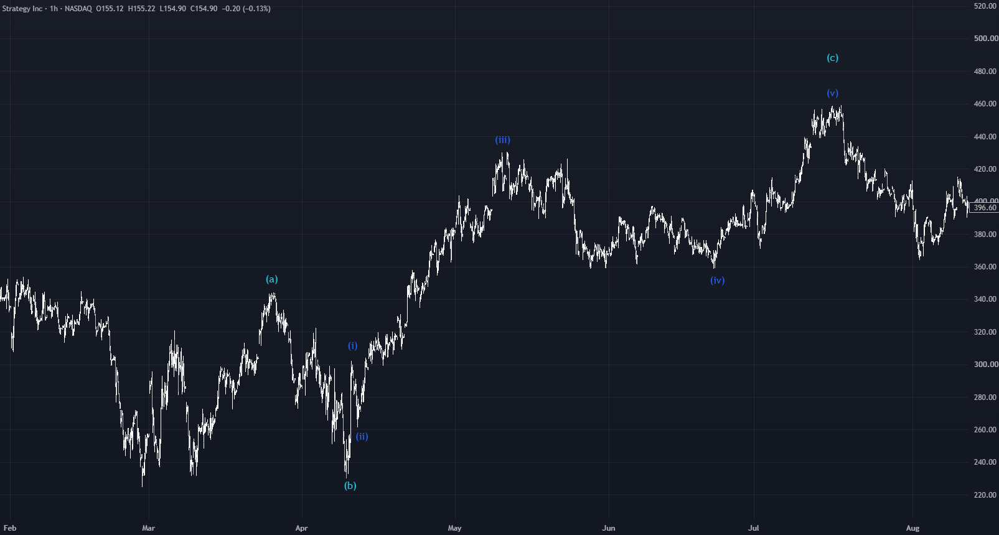
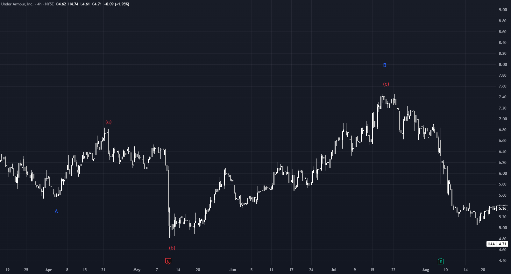
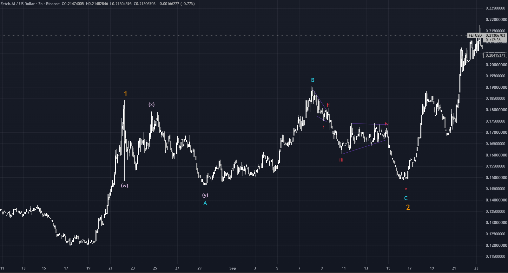
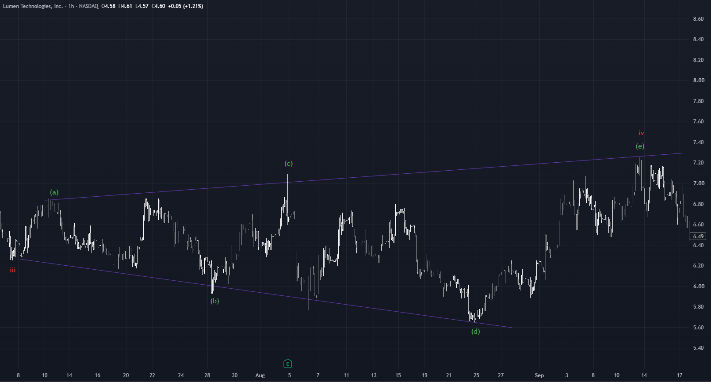
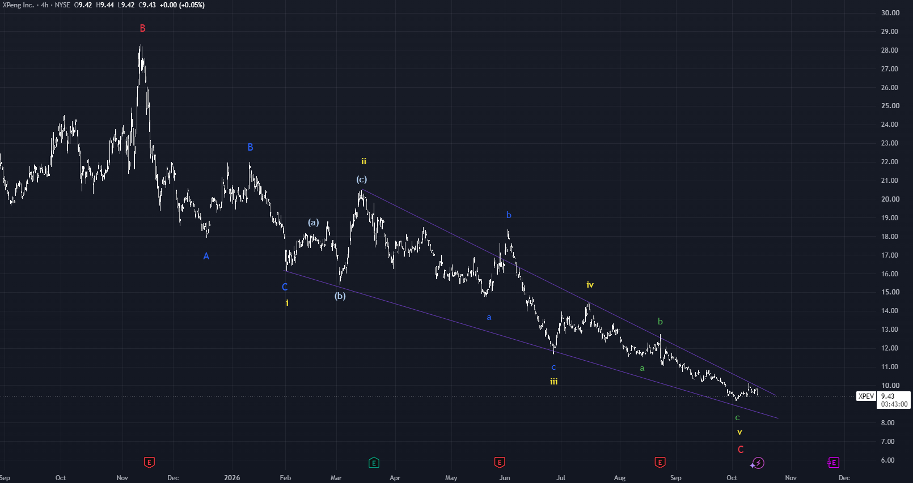

# Elliott-Wellen Regelwerk – Lernversion

Dieses Regelwerk erklärt alle Elliott-Wellen-Muster, die du im Wave Checker übst, mit ihren Regeln und Faustregeln. Es beruht auf Phantoms Buch und folgt genau den Regeln, nach denen die App prüft.

## So liest du dieses Regelwerk

Nicht jede Aussage über Elliott-Wellen ist gleich streng. Darum hat jede Aussage hier eine von drei Stufen:

| Stufe | Woran du sie erkennst | Was ein Verstoß bedeutet |
| --- | --- | --- |
| **Regel** | „muss“, „darf nie“, „niemals“ | Die Zählung ist falsch. |
| **Warnsignal** | „mindestens“, „sollte“ | Die Zählung ist fragwürdig, aber nicht sicher falsch. |
| **Faustregel** | „meist“, „oft“, „am häufigsten“, „in der Regel“ | Nur ein Hinweis, was typisch ist. Kein Fehler. |

**Richtung:** Impulse und Diagonalen sind hier für steigende Kurse beschrieben, Korrekturen für fallende Kurse. Im umgekehrten Fall gilt alles spiegelbildlich: aus „Hoch“ wird „Tief“, aus „über“ wird „unter“. Jedes Muster kann in beide Richtungen auftreten. Auch Korrekturen können zu steigenden Kursen führen.

**Berührung:** Erreichen zwei Wellen genau denselben Preis, zählt das so: Berührt Welle 4 das Ende von Welle 1, ist das schon eine Überlappung. Endet Welle C genau auf dem Tief von Welle A, ist das kein neues Tief. Sind Welle 3 und Welle 1 gleich lang, ist Welle 3 nicht die kürzeste.

**Mehrere Zählungen sind möglich.** Eine Zählung ist entweder regelkonform oder nicht. Oft passen mehrere Zählungen zu einem Chart. Die Regeln sagen dir, welche ausscheiden, nicht welche die einzig richtige ist.

## Grundbegriffe und Fibonacci

Mit diesen Begriffen arbeitet das ganze Regelwerk:

- **Impulsiv:** fünfteilig, also aus den Subwellen 1-2-3-4-5 aufgebaut.
- **Korrektiv:** dreiteilig, also aus den Subwellen A-B-C oder W-X-Y aufgebaut. Ausnahmen sind das Dreieck und die Dreifache Form (W-X-Y-X-Z): Sie haben fünf Wellen, sind aber trotzdem Korrekturen und kein Impuls.
- **Subwellen:** Jede Welle besteht aus kleineren Wellen, und diese wieder aus noch kleineren. Das nennt man Fraktalität.
- **Preisterritorium einer Welle:** der Preisbereich zwischen ihrem Start- und ihrem Endpunkt.
- **Retracement:** wie weit eine Welle eine andere zurücklaufen lässt, in Prozent. Du ziehst das Fibonacci-Retracement über Start- und Endpunkt der Bezugswelle.
- **Expansion:** eine verlängerte Welle. Manchmal meint das Wort auch das Längenverhältnis einer Welle.
- **Expansionsniveau:** die Länge einer Welle in Prozent einer Bezugswelle (Fibonacci-Expansion).
- **Truncation:** Welle 5 endet unter dem Hoch von Welle 3 (mehr dazu beim Impuls).
- **Alternation:** Welle 2 und Welle 4 bilden unterschiedliche Korrekturmuster (mehr dazu beim Impuls).

**Fibonacci.** Die Fibonacci-Folge lautet 0, 1, 1, 2, 3, 5, 8, 13, 21 … Teilt man eine Zahl durch die nächste, ergibt sich 61,8 %. Diese Verhältnisse geben Hinweise auf mögliche Kursziele.

- **Wichtige Retracement-Verhältnisse:** 23,6 %, 38,2 %, 50 %, 61,8 %, 78,6 %, 88,7 %. Am wichtigsten sind 38,2 %, 50 % und 61,8 %, die anderen ergänzen sie.
- **Expansionsniveaus in diesem Regelwerk:** 38,2 %, 61,8 %, 100 %, 123,6 %, 138,2 %, 161,8 %, 261,8 %. Diese Liste ist aus den Regeln unten zusammengetragen und stammt nicht als Liste aus dem Buch.

*Abbildung 1: So ziehst du ein Fibonacci-Retracement in TradingView. Erster Klick: das Fibonacci-Werkzeug wählen. Zweiter Klick: Startpunkt der Bezugswelle. Dritter Klick: Endpunkt der Bezugswelle. Die Linien zeigen, wie weit der Kurs danach zurücklaufen kann (Palantir). Chart erstellt mit TradingView.*

## Alle Muster auf einen Blick

Elliott-Wellen bestehen aus Bewegungen mit dem Trend (Impulse, Diagonalen) und Korrekturen gegen ihn.

| Muster | Aufbau (Teile je Welle) | Wo es vorkommt |
| --- | --- | --- |
| Impuls | 1, 3, 5 fünfteilig, 2 und 4 dreiteilig | Welle 1, 3, 5 und C, Welle A nur im Zigzag (in Flats ist A dreiteilig) |
| Zigzag | A und C fünfteilig, B dreiteilig | Welle 2, 4, A, B, W, X, Y, X, Z, jeder Dreieckswelle und jeder Welle einer Diagonale |
| Regular Flat | 3-3-5 | Welle 2, 4, A, B, W, X, Y, X, Z und jeder Dreieckswelle |
| Expanded Flat | 3-3-5 | Welle 2, 4, A, B, W, X, Y, X, Z und jeder Dreieckswelle |
| Running Flat | 3-3-5 | Welle 2, 4, A, B, W, X, Y, X, Z und jeder Dreieckswelle |
| Dreieck | 5 Wellen A-B-C-D-E, jede dreiteilig | oft Welle 4, auch B und X, selten Y; nie 2, C, W, Z |
| Leading Diagonale | 5-3-5-3-5 oder 3-3-3-3-3 | nur Welle 1 |
| Beendende Diagonale | 3-3-3-3-3 | nur Welle 5 und C |
| Expandierende Diagonale | 3-3-3-3-3 | nur Welle 1, 5 und C (äußerst selten) |
| Double Zigzag | W-X-Y | Welle 2, 4, A, B, W, X, Y, X, Z und jeder Dreieckswelle |
| Dreifache Form | W-X-Y-X-Z | Welle 2 und 4 |

## Der Impuls (1-2-3-4-5)

Der Impuls ist die Grundbewegung mit dem Trend. Die Wellen 1, 3 und 5 laufen in Trendrichtung und sind selbst fünfteilig. Die Wellen 2 und 4 sind kleinere Korrekturen dagegen.

**Die Regeln des Impulses**

1. **Welle 2 darf den Start von Welle 1 nicht unterschreiten** (im Abwärtstrend: nicht überschreiten). Einzige Ausnahme: Entstand Welle 1 direkt nach einem Börsengang (IPO, ICO), darf Welle 2 ein neues Tief bilden.
2. **Welle 3 ist nie die kürzeste** der drei Impulswellen 1, 3 und 5.
3. **Welle 4 darf nicht ins Preisterritorium von Welle 1 laufen.** Ausnahme: Diagonalen, dort ist genau diese Überlappung typisch.
4. **Welle 1, 3 und 5 laufen immer mit dem Trend** und sind impulsiv, bestehen also jeweils aus 1-2-3-4-5.
5. **Welle 2 und 4 laufen gegen den Trend.** Faustregel: Sie sind in der Regel dreiteilig.

**Welle 1**

- Regel: impulsiv fünfteilig (1-2-3-4-5).
- Kann auch eine Diagonale sein: eine Leading Diagonale oder, selten, eine Expandierende Diagonale.

**Welle 2**

- Regel: korrektiv. Möglich sind Zigzag, jede Flat, Double- oder Triple-Zigzag. **Nie ein Dreieck.**
- Regel: darf nicht unter den Start von Welle 1 laufen (siehe oben, mit IPO/ICO-Ausnahme).
- Faustregel: Am häufigsten läuft sie 50 %, 61,8 % oder 78,6 % von Welle 1 zurück (Retracement über Start und Ende von Welle 1).

**Welle 3**

- Regel: impulsiv fünfteilig, deshalb **nie eine Diagonale**.
- Regel: nie die kürzeste der Wellen 1, 3 und 5.
- Faustregel: Verlängerte Wellen treten am häufigsten in Welle 3 auf.
- Warnsignal: Welle 3 sollte **mindestens 123,6 %** erreichen. Faustregel: meist 161,8 % bis 261,8 %, bei Übertreibungen auch mehr. Gemessen mit der Fibonacci-Expansion über Start und Ende von Welle 1 sowie das Ende von Welle 2.

**Welle 4**

- Regel: korrektiv. Möglich sind Zigzag, jede Flat, Dreieck, Double- oder Triple-Zigzag.
- Regel: darf Welle 1 nicht überlappen (Ausnahme: Diagonale).
- Regel, **Alternation:** Welle 4 bildet ein anderes Korrekturmuster als Welle 2 derselben Wellenebene.
- Warnsignal: Sind Welle 2 und 4 zwei verschiedene Flat-Varianten (zum Beispiel Regular und Expanded Flat), ist das erlaubt, aber nicht ganz sauber. Dieselbe Flat-Variante in beiden Wellen verstößt gegen die Alternation.
- Faustregel: Am häufigsten läuft sie 38,2 % oder 50 % von Welle 3 zurück (Retracement über Start und Ende von Welle 3).

**Welle 5**

- Regel: impulsiv fünfteilig (1-2-3-4-5).
- Kann auch eine Diagonale sein: eine Beendende oder eine Expandierende Diagonale.
- Warnsignal: Welle 5 sollte **mindestens 38,2 %** erreichen. Faustregel: meist 61,8 % bis 261,8 %, wenn sie sich verlängert. Gemessen mit der Fibonacci-Expansion über den Start von Welle 1 sowie die Enden von Welle 3 und 4.
- **Truncation:** In Ausnahmefällen endet Welle 5 unter dem Hoch von Welle 3 (im Abwärtstrend: über dem Tief). Das passiert, wenn dem Markt die Kraft ausgeht. Für eine solche Welle 5 gelten dieselben Regeln, nur die Kursziele sind niedriger.

*Abbildung 2: Impuls mit eingezeichneten Subwellen (FET/USD). Chart erstellt mit TradingView.*

## Das Zigzag (A-B-C)

Das Zigzag ist das bekannteste Korrekturmuster. Es verläuft zickzackförmig in drei Wellen: A und C mit der Korrekturrichtung, B dagegen. Beschrieben ist es hier für fallende Kurse.

**Welle A**

- Regel: impulsiv fünfteilig (1-2-3-4-5).
- Regel: **keine Diagonale.**

**Welle B**

- Regel: dreiteilig, als Zigzag, Flat, Dreieck oder Double-Zigzag.
- Regel: darf den **Start von Welle A nicht überschreiten**. Sie läuft also höchstens 99,9 % von Welle A zurück. 100 % wäre schon ein Regelbruch.

**Welle C**

- Regel: muss **unter dem Ende von Welle A** enden.
- Regel: entweder ein klassischer Fünfteiler oder eine Beendende Diagonale.
- Faustregel: Am häufigsten ist C genau so lang wie A (100 %). Üblich sind 61,8 % bis 161,8 % von A.

*Abbildung 3: Zigzag-Korrektur, Welle (c) mit Subwellen (PayPal). Chart erstellt mit TradingView.*

## Die Flats (A-B-C, 3-3-5)

Alle drei Varianten haben denselben Aufbau 3-3-5. Sie unterscheiden sich darin, wo B und C enden. Beschrieben sind sie hier für fallende Kurse.

**Was für alle Flats gilt**

- **Welle A:** dreiteilig, als Zigzag, Flat oder Double-Zigzag.
- **Welle B:** dreiteilig, jedes Korrekturmuster ist möglich, ein Dreieck ist am unwahrscheinlichsten. Warnsignal: B sollte **mindestens 88,7 % und höchstens 161,8 %** von A zurücklaufen.
- **Welle C:** ein klassischer Fünfteiler oder eine Beendende Diagonale. Faustregel: Am häufigsten erreicht C ein Kursziel von 100 % von A (C ist so lang wie A), bis zu 261,8 % sind möglich.

**Die drei Varianten im Vergleich**

| Variante | Welle B | Welle C |
| --- | --- | --- |
| Regular Flat | nähert sich dem Start von A an | endet leicht unter dem Tief von A |
| Expanded Flat | überschreitet den Start von A | endet unter dem Tief von A |
| Running Flat | überschießt den Start von A | schafft kein neues Tief unter A |

*Abbildung 4: Regular Flat (MicroStrategy). Chart erstellt mit TradingView.*

*Abbildung 5: Expanded Flat (a)-(b)-(c) als Welle B, hier aufwärts: (b) unterschreitet den Start von (a) (Under Armour). Chart erstellt mit TradingView.*

*Abbildung 6: Running Flat (FET/USD). Chart erstellt mit TradingView.*

## Dreiecke (A-B-C-D-E)

Dreiecke erkennst du an ihren Trendlinien. Ein Dreieck hat fünf Wellen A-B-C-D-E, und **jede davon ist dreiteilig**. Die Teilmuster dürfen wechseln, zum Beispiel A als Zigzag, B als Flat und C wieder als Zigzag.

**Wo Dreiecke vorkommen**

- Regel: **nie** in Welle 2, C, W oder Z.
- In den Wellen B und X, selten auch in Welle Y.
- Faustregel: häufig in Welle 4.
- Faustregel: Dreiecke verlaufen meist flach.

**Die zwei Arten**

| Art | Regel |
| --- | --- |
| Kontrahierendes Dreieck | A ist die längste der fünf Wellen, jede Welle ist kürzer als die vorherige. Die Trendlinien laufen aufeinander zu. |
| Expandierendes Dreieck | A ist die kürzeste der fünf Wellen, jede Welle ist länger als die vorherige. Die Trendlinien laufen auseinander. |

*Abbildung 7: Expandierendes Dreieck (Lumen). Chart erstellt mit TradingView.*

## Diagonalen (1-2-3-4-5)

Diagonalen sind fünfteilige Bewegungen mit dem Trend, aber anders gebaut als der Impuls. Ihr wichtigstes Kennzeichen: **Welle 4 überlappt Welle 1.** Beim Impuls wäre das ein Fehler, bei der Diagonale gehört es dazu.

**Was für alle Diagonalen gilt**

- Verbindest du die Hochs von 1, 3 und 5 und die Tiefs von 2 und 4 mit Trendlinien, entsteht die typische Diagonalform. Welle 5 kann die obere Trendlinie durchbrechen oder sie gar nicht erreichen.
- Die Fibonacci-Niveaus der Diagonalen unterscheiden sich von denen des Impulses.
- Regel: Welle 2 darf den **Start von Welle 1 nicht unterschreiten** (im Abwärtstrend: nicht überschreiten), genau wie beim Impuls.
- Regel: Die Diagonale **kommt voran**: Welle 3 endet über dem Ende von Welle 1, und Welle 5 endet über dem Ende von Welle 3 (im Abwärtstrend: jeweils darunter).
- Bei kontrahierenden Diagonalen (Leading und Beendende) werden die Wellen immer kürzer: Welle 1 ist länger als Welle 3, Welle 3 länger als Welle 5. Bei der Beendenden Diagonale ist das nicht ganz so streng.

**Leading Diagonale**

- Kommt **nur in Welle 1** vor und ersetzt dort den Impuls.
- Aufbau: 5-3-5-3-5 oder 3-3-3-3-3. Die Subwellen von 1, 3 und 5 sind Zigzags oder klassische Impulse.
- Regel: Welle 1 ist die längste der trendgebenden Wellen 1, 3 und 5. Welle 3 ist nie die kürzeste. Welle 5 ist **kürzer als Welle 3**, gleich lang reicht nicht.
- Regel: Welle 2 und Welle 4 dürfen jedes Korrekturmuster sein, **außer einem Dreieck**.
- Faustregel: Retracements und Expansionen liegen meist bei 61,8 %.

**Beendende Diagonale** (auch Ending Diagonale)

- Kommt **nur in Welle 5 und Welle C** vor.
- Aufbau: 3-3-3-3-3. Die Wellen 1, 3 und 5 sind jeweils ein Zigzag.
- Regel: Die Überlappung von Welle 1 und 4 ist auch hier Pflicht.
- Regel: Welle 3 ist **kürzer als Welle 1**, aber nie die kürzeste Welle.
- Regel: Welle 5 ist ein Zigzag und **nicht länger als Welle 3** (höchstens 99,9 % davon).
- Regel: Welle 2 darf jedes Korrekturmuster außer einem Dreieck sein. Welle 4 darf jedes Korrekturmuster sein, auch ein Dreieck.
- Faustregel: Welle 1 ist meistens die längste der fünf Wellen.
- Faustregel: Welle 4 läuft oft 61,8 % zurück.

*Abbildung 8: Beendende Diagonale (XPeng). Chart erstellt mit TradingView.*

**Expandierende Diagonale**

- Kommt **äußerst selten** vor, und nur in Welle 1, 5 und C.
- Aufbau: immer 3-3-3-3-3. Die Wellen 1, 3 und 5 müssen Zigzags sein.
- Regel: Die Wellen werden **immer länger**: Welle 1 ist kürzer als Welle 3, Welle 3 kürzer als Welle 5.
- Regel: Welle 2 darf jedes Korrekturmuster außer einem Dreieck sein. Welle 4 darf jedes Korrekturmuster sein.
- Regel: Welle 4 läuft **höchstens 99,9 %** von Welle 3 zurück (Retracement über Start und Ende von Welle 3). Faustregel: meist 50 % bis 88,7 %, am häufigsten 61,8 %.
- Faustregel: Welle 3 und 5 erreichen meist 138,2 %. Welle 2 und 4 laufen oft 61,8 % zurück.

## Komplexe Korrekturen: W-X-Y und W-X-Y-X-Z

Komplexe Korrekturen hängen mehrere Korrekturmuster aneinander, verbunden durch X-Wellen.

- **Double Zigzag (W-X-Y):** W, X und Y sind jeweils ein Korrekturmuster. Jede dieser Wellen kann ein anderes Muster bilden und muss kein Zigzag sein, zum Beispiel W als Zigzag, X als Dreieck, Y als Regular Flat. Dasselbe Muster darf auch mehrfach vorkommen, etwa W und Y beide als Zigzag.
- **Dreifache Form (W-X-Y-X-Z):** die Verlängerung von W-X-Y. Eine zweite X-Welle hängt ein drittes Korrekturmuster an, die Z-Welle. Auch hier dürfen Muster mehrfach vorkommen. W-X-Y-X-Z kann in Welle 2 und Welle 4 vorkommen.
- Warnsignal bei der Dreifachen Form: Y **sollte unter dem Ende von W** enden und Z **unter dem Ende von Y** (bei steigenden Kursen: jeweils darüber). In seltenen Fällen bilden Y und Z kein neues Tief.
- Regel bei der Dreifachen Form: Y und Z dürfen **nicht beide versagen**. Mindestens eine der beiden Wellen muss ein neues Tief bilden (Y unter dem Ende von W oder Z unter dem Ende von Y).
- Die Regeln für W, X, Y und Z gelten in beiden Formen gleich:

**Welle W**

- Regel: eine A-B-C- oder W-X-Y-Formation, **nie ein Dreieck**.
- Faustregel: korrigiert meist 38,2 % bis 50 % der vorherigen Welle.

**Welle X**

- Eine A-B-C- oder W-X-Y-Formation, auch ein Dreieck ist möglich.
- Regel: X läuft **weniger als 100 %** von W zurück. 100 % oder mehr ist ein Regelbruch. Phantom lässt damit, anders als manche andere Elliott-Analysten, keine überschießende X-Welle zu.
- Warnsignal: Mehr als 88,7 % (bis knapp unter 100 %, z. B. 99,9 %) ist erlaubt, aber ein starkes Warnsignal.
- Warnsignal: X sollte **mindestens 38,2 %** erreichen. Faustregel: am häufigsten 61,8 %.

**Welle Y**

- Eine A-B-C- oder W-X-Y-Formation, auch ein Dreieck ist möglich (selten).
- Faustregel: am häufigsten 100 %. Spielraum von 61,8 % bis, in Extremfällen, 261,8 %.

**Welle Z**

- Regel: eine A-B-C- oder W-X-Y-Formation, **nie ein Dreieck**.
- Faustregel: am häufigsten 100 %. Spielraum von 61,8 % bis 161,8 %.

## Quelle

Alle Regeln stammen aus Phantoms Buch und wurden von Lenny für den Wave Checker zusammengefasst und an einigen Stellen präzisiert. Die Beispielcharts sind mit TradingView erstellt.
